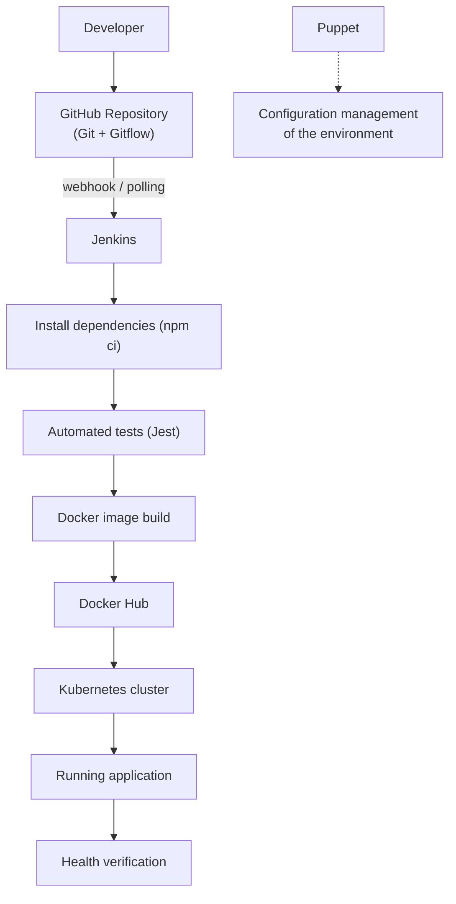

# student-mgmt
# End-to-End CI/CD Automation Platform for a Containerized Web Application

**Design and Implementation of an Automated CI/CD Pipeline Using Jenkins, Docker, Kubernetes, and Puppet**

A complete software delivery pipeline: a developer pushes code to GitHub, and Jenkins automatically installs dependencies, runs tests, builds a Docker image, pushes it to Docker Hub, deploys it to a Kubernetes cluster, and verifies the deployment with a health check. Puppet manages the configuration of the target environment.

---

## Table of Contents

1. [Description](#description)
2. [Architecture](#architecture)
3. [Tech Stack](#tech-stack)
4. [Features](#features)
5. [Project Structure](#project-structure)
6. [Prerequisites](#prerequisites)
7. [How to Run](#how-to-run)
8. [Pipeline Stages](#pipeline-stages)
9. [Gitflow Workflow](#gitflow-workflow)
10. [What to Check](#what-to-check)
11. [Screenshots](#screenshots)
12. [Likely Viva Questions](#likely-viva-questions)
13. [Future Work](#future-work)
14. [Troubleshooting](#troubleshooting)

---

## Description

### Problem statement

Software teams often perform builds, testing, container creation, deployment, and server configuration manually. This leads to inconsistent environments, deployment errors, and slow releases.

### Solution

This project automates the whole delivery process, from a developer committing code to the application running in a Kubernetes cluster. The workload being deployed is a **Student Management System** (Node.js, Express, MongoDB, React) that exposes REST APIs and a `/health` endpoint. The focus of the project is the DevOps automation around the application, not the application features.

---

## Architecture



This is a logical architecture. Jenkins drives build and deployment, while Puppet configures the environment the pipeline runs against.

---

## Tech Stack

| Area | Technology |
|---|---|
| Source control | Git, GitHub, Gitflow |
| CI/CD | Jenkins (Multibranch Pipeline) |
| Containerization | Docker, Docker Hub |
| Orchestration | Kubernetes (Docker Desktop) |
| Configuration management | Puppet |
| Backend | Node.js, Express, Mongoose |
| Database | MongoDB |
| Frontend | React (Vite) |
| Testing | Jest, Supertest |
| Platform | Windows 10/11, PowerShell, WSL2 |

---

## Features

- Developers push code to GitHub.
- Jenkins detects changes and starts a pipeline.
- Jenkins installs dependencies using npm.
- Automated tests run, and the pipeline fails if they fail.
- Jenkins builds a Docker image.
- The image is pushed to Docker Hub.
- The application is deployed to Kubernetes.
- A health check verifies the deployment.
- Puppet manages the configuration of a designated environment.
- Git history and pipeline logs provide traceability.

Additional design choices: images are tagged `<build-number>-<commit-sha>`, deployments use rolling updates with `maxUnavailable: 0`, readiness and liveness probes use `/health`, and a failed deployment on `main` triggers an automatic rollback.

---

## Project Structure

```
student-mgmt/
├── app.js               # Express app and REST routes
├── server.js            # Starts the server and connects to MongoDB
├── app.test.js          # Jest tests
├── package.json
├── package-lock.json
├── client/              # React frontend (Vite)
├── Dockerfile
├── .dockerignore
├── Jenkinsfile          # Pipeline definition
├── k8s/
│   ├── mongo.yaml       # MongoDB Deployment and Service
│   └── app.yaml         # App Deployment (2 replicas) and NodePort Service
└── puppet/
    └── site.pp          # Environment configuration
```

---

## Prerequisites

Windows 10/11 with WSL2 enabled, 16 GB RAM recommended (8 GB minimum), and accounts on GitHub and Docker Hub.

Install the tools from an **Administrator PowerShell**:

```powershell
winget install -e --id Git.Git
winget install -e --id OpenJS.NodeJS.LTS
winget install -e --id EclipseAdoptium.Temurin.21.JDK
winget install -e --id Docker.DockerDesktop
winget install -e --id Puppet.puppet-agent
Set-ExecutionPolicy -Scope CurrentUser RemoteSigned
```

Restart Windows, then verify in a new PowerShell:

```powershell
git --version ; node -v ; java -version ; docker --version ; kubectl version --client
```

Jenkins requires **Java 21 or newer**. In Docker Desktop, keep Linux containers and the WSL 2 engine enabled, then enable Kubernetes under **Settings, Kubernetes, Enable Kubernetes**.

---

## How to Run

### 1. Clone the repository

```powershell
git clone https://github.com/yashwanth-20055/student-mgmt.git
cd student-mgmt
```

### 2. Run the application locally

```powershell
npm install
npm test
node server.js
```

Open `http://localhost:3000/health`. You should see `{"status":"UP","db":"DOWN",...}`. The database shows `DOWN` because MongoDB is not running locally, which is expected at this stage.

### 3. Build and run the Docker image

Start Docker Desktop first.

```powershell
docker build -t YOUR_DOCKERHUB_USER/student-mgmt:local .
docker run --rm -p 3000:3000 YOUR_DOCKERHUB_USER/student-mgmt:local
curl.exe localhost:3000/health
```

### 4. Apply the Puppet configuration

```powershell
puppet apply --noop .\puppet\site.pp    # dry run
puppet apply .\puppet\site.pp
puppet apply .\puppet\site.pp           # second run reports no changes (idempotent)
Get-Content C:\student-app\app.conf
```

### 5. Set up Jenkins

```powershell
mkdir C:\jenkins
Invoke-WebRequest https://get.jenkins.io/war-stable/latest/jenkins.war -OutFile C:\jenkins\jenkins.war
$env:JENKINS_HOME = "C:\jenkins\home"
java -jar C:\jenkins\jenkins.war --httpPort=8080
```

1. Open `http://localhost:8080` and unlock Jenkins with the password from `C:\jenkins\home\secrets\initialAdminPassword`.
2. Install the suggested plugins.
3. Add credentials under **Manage Jenkins, Credentials, Global**:

   | ID | Type | Value |
   |---|---|---|
   | `dockerhub` | Username with password | Docker Hub username and an access token (Read & Write) |
   | `kubeconfig` | Secret file | Output of the command below |

   ```powershell
   kubectl config use-context docker-desktop
   kubectl config view --raw --flatten | Out-File -Encoding ascii kubeconfig
   ```

4. Create a **Multibranch Pipeline** job named `student-mgmt` with this repository as a GitHub branch source.
5. Set the `IMAGE` value in the `Jenkinsfile` to `YOUR_DOCKERHUB_USER/student-mgmt`.

Never commit the `kubeconfig` file. It is listed in `.gitignore`.

### 6. Trigger builds

**Option A, webhook (instant builds).** Expose Jenkins with ngrok and add a GitHub webhook.

```powershell
ngrok http 8080
```

In GitHub, go to **Settings, Webhooks, Add webhook**, with payload URL `https://<your-ngrok-address>/github-webhook/`, content type `application/json`, and the push event. This requires the **GitHub** plugin in Jenkins.

**Option B, polling (no tunnel needed).** In the job configuration, enable **Periodically if not otherwise run** with a 1 minute interval.

### 7. Deploy and verify

```powershell
git add .
git commit -m "feat: trigger pipeline"
git push origin main
```

When the build on `main` is green:

```powershell
kubectl get pods,svc
Invoke-RestMethod http://localhost:30080/health

Invoke-RestMethod -Method Post -Uri http://localhost:30080/api/students `
  -ContentType 'application/json' `
  -Body '{"name":"Asha","roll":"CS101","branch":"CSE"}'
Invoke-RestMethod http://localhost:30080/api/students
```

---

## Pipeline Stages

| # | Stage | What it does | Branches |
|---|---|---|---|
| 1 | Install | `npm ci` installs exact dependency versions | all |
| 2 | Test | `npm test` (Jest); the pipeline fails if tests fail | all |
| 3 | Docker Build | Builds the image tagged `<build>-<commit>` and `latest` | all |
| 4 | Push to Docker Hub | Logs in with the `dockerhub` credential and pushes both tags | all |
| 5 | Deploy to Kubernetes | Applies `k8s/` manifests, waits for the rollout | `main` |
| 6 | Health Verification | Runs a temporary curl pod against `/health` | `main` |
| Post | Rollback and cleanup | `kubectl rollout undo` on failure, then `docker logout` | `main` |

---

## Gitflow Workflow

```powershell
git checkout -b develop
git checkout -b feature/my-feature develop
git commit -am "feat: describe the change"
git checkout develop ; git merge --no-ff feature/my-feature
git checkout main ; git merge --no-ff develop
git tag -a v1.0.0 -m "Release 1.0.0" ; git push origin main --tags
```

Feature and develop branches run the build and push stages. Only `main` deploys to Kubernetes.

---

## What to Check

- [ ] `npm test` passes locally (2 tests).
- [ ] The Docker image builds and `/health` returns `UP` on `localhost:3000`.
- [ ] `puppet apply` creates `C:\student-app\app.conf`, and a second run reports no changes.
- [ ] Jenkins is reachable on port 8080 and the `dockerhub` and `kubeconfig` credentials exist.
- [ ] A push to GitHub starts a Jenkins build (webhook delivery shows a green tick, or polling picks it up).
- [ ] All stages pass: Install, Test, Docker Build, Push, Deploy, Health Verification.
- [ ] Docker Hub shows the new `<build>-<commit>` tag and `latest`.
- [ ] `kubectl get pods,svc` shows 2 `student-app` pods and 1 `mongo` pod running.
- [ ] `http://localhost:30080/health` returns the running build number in `version`.
- [ ] A deliberately failing test stops the pipeline before any image is pushed.
- [ ] A bad deployment on `main` is rolled back and the old pods keep serving.
- [ ] Git history and the Jenkins build log trace a running image back to its commit.

---
